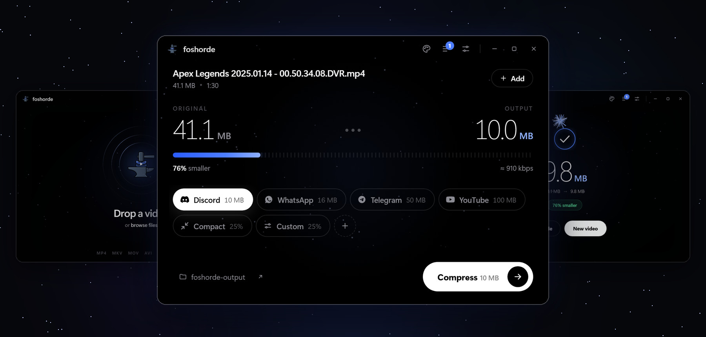
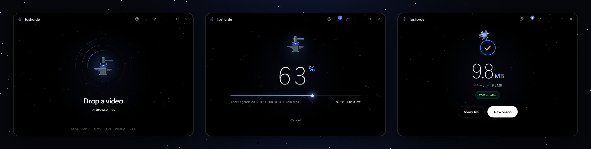
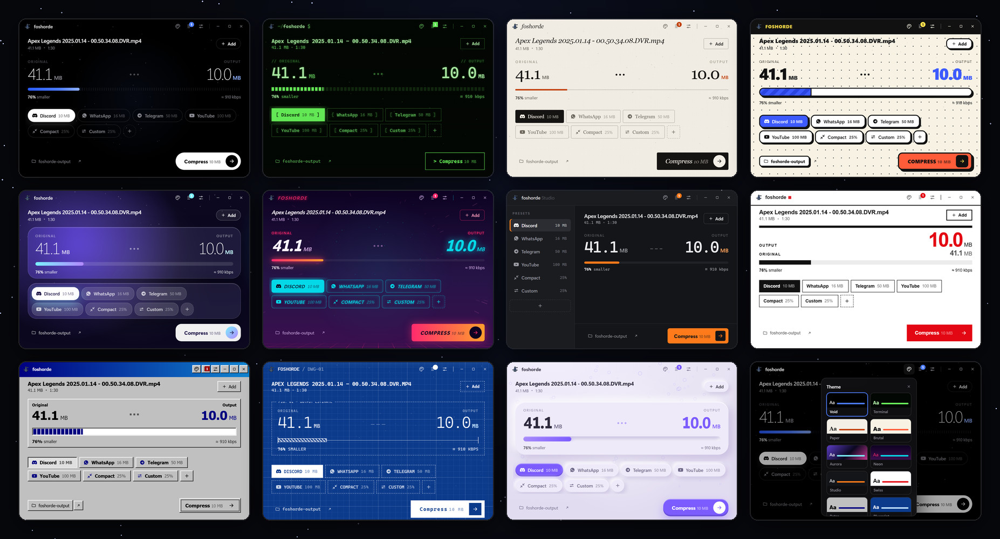
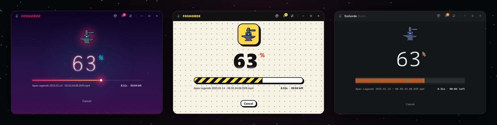

<p align="center">
  
</p>

<h1 align="center">Foshorde</h1>

<p align="center">
  Drop a video. Pick a size. Done.<br />
  <sub>A tiny, GPU-accelerated video compressor for Windows.</sub>
</p>

<p align="center">
  <a href="https://github.com/Acid-hastam/Foshorde/releases"><b>Download</b></a>
  &nbsp;·&nbsp;
  <a href="#themes">Themes</a>
  &nbsp;·&nbsp;
  <a href="#build">Build</a>
</p>

<p align="center">
  
</p>

## Why

- **Hits a target size.** Discord 10 MB, WhatsApp 16 MB, Telegram 50 MB, a percentage, or your own preset.
- **Fast.** H.265 on your GPU (NVIDIA, AMD or Intel), with a CPU fallback.
- **Keeps quality.** HDR and 10-bit are preserved, and the output plays everywhere (`.mp4`, `hvc1`).
- **Zero setup.** One portable `.exe`. FFmpeg downloads itself on first launch.

<p align="center">
  
</p>

## Themes

Eleven of them, each with its own layout and its own animations. Click the palette button or press <kbd>Ctrl</kbd>+<kbd>T</kbd> to switch.

<p align="center">
  
</p>

<p align="center">
  
  <br /><sub>Even the progress screen changes: warp stars, hazard stripes, a render timeline.</sub>
</p>

## Use

1. Run `Foshorde.exe`.
2. Drop one or more videos onto the window.
3. Pick a preset and hit **Compress**. The files land in `foshorde-output/`.

## Build

Needs [Rust](https://rustup.rs) and [Node.js](https://nodejs.org).

```bash
cd foshorde-gui
npm install
npm run tauri build -- --no-bundle
```

The exe ends up at `foshorde-gui/src-tauri/target/release/foshorde-gui.exe`.

<p align="center"><sub>Tauri v2 · Rust · FFmpeg · MIT</sub></p>
